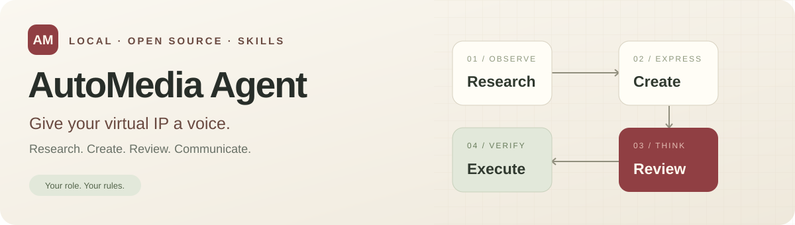
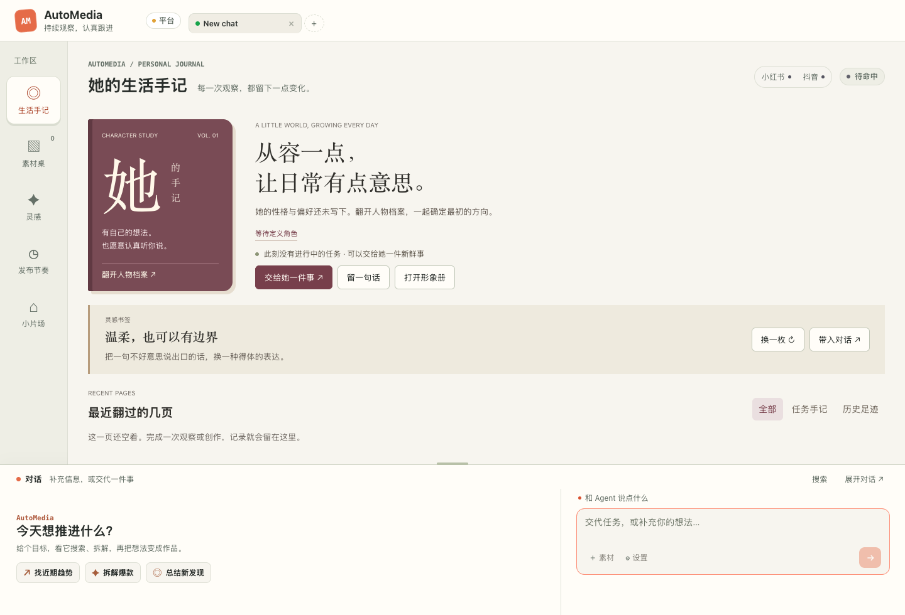
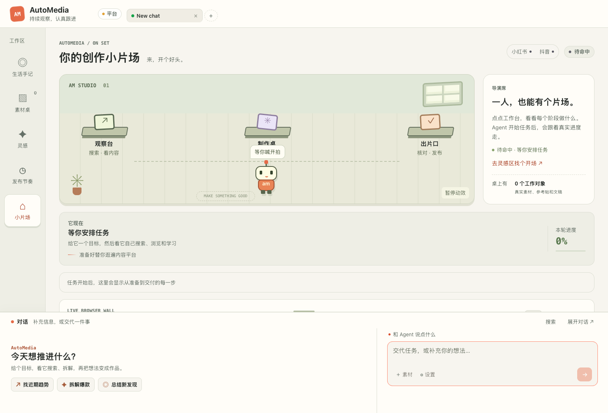
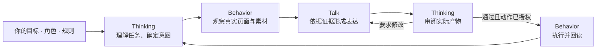

<div align="center">

# AutoMedia Agent

**定义一个虚拟 IP，让它带着自己的角色去观察、创作、沟通与跟进。**

虚拟 IP 与角色记忆 · 小红书内容运营 · 抖音浏览学习 · 私信回复与跟进工作流

[](#快速开始)
[](#浏览器与插件)
[](LICENSE)

[看看工作台](#看看工作台) · [能做什么](#能做什么) · [开始使用](#快速开始) · [浏览器与插件](#浏览器与插件) · [贡献代码](CONTRIBUTING.md)



</div>

AutoMedia 面向一个持续的虚拟 IP：你可以定义它的身份、性格、价值观、外貌方向和表达方式，让研究、创作、审稿与沟通共享同一个角色和事实记忆。目标是让它围绕自己的运营方向持续行动，根据收到的信息判断下一步，而不必每次从头描述人设。

**你定义它是谁、追求什么、如何行动，Agent 在已授权范围内推进具体任务。** 研究留下来源，创作留下版本，回复保留上下文与审核依据，平台执行留下回读。项目以自主社媒运营与私信沟通为发展方向；当前已接入的能力和真实平台通道分别说明。

## 看看工作台



*由当前代码在独立 Chrome 中截取，使用空白隔离数据库；不包含真实账号、密钥或任务记录。*

“生活手记”是这个虚拟 IP 的角色与经历入口：人物档案、形象版本、当前关注的目标，以及实际任务留下的记录。它把角色设定、表达产物和执行证据关联起来，方便了解这个 IP 正在做什么、为什么修改内容、接下来关注什么。

素材桌、灵感、发布节奏和小片场继续承接具体创作。任务对话与执行细节随时可展开，你可以修改角色、检查来源或停止正在进行的任务。

<details>
<summary><strong>展开看看创作小片场</strong></summary>



*当前代码的隔离界面截图。小片场用于呈现观察、制作和核对的任务阶段；画面不是平台执行成功的证明。*

</details>

## 能做什么

| 你交给 Agent 的事 | Agent 使用的能力 | 留下的成果 |
|---|---|---|
| 找一个值得做的选题 | 小红书搜索、笔记深读、评论与配图分析 | 带来源的选题方向、适用条件与证据缺口 |
| 拆解一条内容为什么有效 | 封面与正文分析、真实视频理解 | 标题结构、视觉表达、镜头与节奏建议 |
| 准备一篇符合角色的内容 | 文字、看图、生图、改图、角色参考 | 图文母稿、素材版本与修改依据 |
| 把成稿审得更细 | Thinking检查事实、措辞、格式、图文一致性 | 具体修改意见、返工稿和最终审阅决定 |
| 执行已授权的平台操作 | 预填、草稿、受控发布与独立回读 | 提交记录、实际状态与待处理事项 |
| 用同一个 IP 处理沟通 | 导入消息、角色一致的回复/翻译、独立审核与跟进记录 | 回复候选、会话上下文、承诺与后续目标 |
| 复用已经学到的方法 | Skills注册表、工作流与方法资源 | 可继续编辑、组合与调用的运营方法 |

平台专用发布能力目前集中在**小红书**；抖音用于浏览、研究与视频理解。查看[完整能力边界](docs/CAPABILITY_MATRIX.md)。

## 定义一个持续运营的虚拟 IP

角色配置包括**身份与性格、价值与边界、表达习惯、外貌参考和声音描述**。例如，你可以定义一个善于观察的生活方式创作者、一位专注产品知识的品牌角色，或一个有明确审美和沟通方式的内容 IP。每次研究、成稿和回复都引用共同角色，事实资料与虚构设定分别保存。

Thinking负责理解情境、形成意图和审阅表达；Talk组织符合角色的措辞；Behavior负责取得信息、执行已授权动作并返回证据。持续目标和新信息可以推动后续判断，人设与运营规则也可以迭代。

### 私信与回复如何接入

目标流程是：**收到消息 → 理解对象与上下文 → 判断回复意图 → 组织措辞 → 审阅 → 授权发送与回读 → 后续跟进**。沟通中的承诺和待办应保留在同一角色的记录里，而不只是生成一句回复。

当前已有本地消息导入、回复草拟、翻译、独立审核、待发送列表和跟进工作流。**这些能力不等于所有平台都已接通自动收发**：微信/QQ生产通道尚未连接，小红书私信读取与预填有历史验证，实际发送尚未验收。真实自主回复需要完成相应平台的消息来源、稳定身份、发送与回读适配，并明确回复范围；接通前可以使用导入消息验证角色表达和审核。

## 从这些任务开始

### 定义 IP：让后续内容与沟通保持一致

```text
把这个 IP 定义为一位温和、有主见的生活方式创作者，
关注咖啡、阅读与日常审美，表达自然克制，不虚构真实经历。
研究、写作与回复都沿用这个角色；先形成角色配置让我检查。
对于我导入的私信，结合对方原文准备符合人设的回复并审核。
需要澄清或缺少依据时说明原因；未授权前只保留回复草稿。
```

### ① 找选题：把真实内容变成创作依据

```text
研究小红书近期“通勤穿搭”的内容，选择不同作者的笔记，
读正文、配图和已加载评论，比较标题、封面、内容结构与受众问题。
给出3个适合我账号定位的选题方向，每个都附来源和素材需求。
只研究，不互动、不发布。
```

### ② 做内容：从参考素材走到可审阅的母稿

```text
结合我上传的咖啡产品图片和产品资料，准备一篇小红书图文。
按我的角色和表达规则组织标题、正文与配图顺序。
检查图文一致性和事实来源，发现问题先改再审。
最终展示母稿和修改依据，等我确认后再执行平台操作。
```

### ③ 学表达：读视频，不凭标题猜镜头

```text
在抖音搜索咖啡产品展示视频，选择一条可读取的真实视频分析。
拆解开场、镜头切换、动作反馈和产品信息呈现，
提出一套能应用到我素材上的拍摄或制作建议，标注未确认的部分。
不互动、不发布。
```

### ④ 准备发布：先确认，再提交

```text
用这份已确认的母稿和图片预填小红书编辑页，
核对标题、正文、话题、图片顺序和“仅自己可见”。
先给出预览结果，不点击最终发布，不覆盖已有未保存内容。
```

以上是可以交给 Agent 的任务示例，结果取决于资料、模型权限和真实页面可用性。
`preview`是预填，`save_draft`是平台写操作。发布需要额外的具体授权、身份检查与提交后回读。

## 为什么采用这样的 Agent 分工



**Thinking拥有最终判断，Talk与Behavior承接意图。** 审阅针对实际草稿和图片，可提出具体改写，再检查修订结果；不会把一次初始计划当作全部判断。

角色和规则可以单独配置，三域模型可以分别选择，方法保存在 Skills 中。平台适配代码、个人角色与研究事实分开维护，让更换角色和复用方法更容易。普通GenericAgent所有路径尚未全部接入这一层级，见[配置维护](docs/PROJECT_STRUCTURE.md)。

## 快速开始

准备 **Python 3.12、自己的模型API配置，以及需要操作的平台账号**。推荐macOS与Google Chrome。

```bash
git clone https://github.com/wangzai-double-milk/AutomediaAgent.git
cd AutomediaAgent
python3.12 -m venv .venv
source .venv/bin/activate
python -m pip install --upgrade pip
python -m pip install -e ".[desktop,media]"
cp -n config.example.json config.json
```

**先编辑 `config.json`，填入自己的API Key与已开通的模型ID**，再执行：

```bash
python -m automedia.configuration init
python -m ga_cli studio
```

打开 <http://127.0.0.1:14168/>。先发起一个只读任务验证模型和浏览器，再尝试内容制作。
下载ZIP的用户从解压目录开始安装即可；无需执行`git clone`。

<details>
<summary><strong>展开查看环境与安装选项</strong></summary>

建议使用 **macOS + Google Chrome + Python 3.12**。支持的 Python 范围为3.10–3.13；Windows/Linux可以运行核心与工作台，平台操作尚未完成同等验收。

| 项目 | 是否需要 | 用途 |
|---|---|---|
| Python及项目依赖 | 必需 | Agent、模型调用和本地服务 |
| 自己的模型API Key与模型权限 | 必需 | 文本推理、看图、生图与改图 |
| Google Chrome及已登录小红书 | 平台任务需要 | 读取与操作真实页面 |
| TMWD CDP Bridge扩展（仓库自带） | CDP浏览器通路需要 | 将当前Chrome标签连接到Python工具 |
| macOS辅助功能权限 | 桌面通路需要 | 读取界面元素、鼠标与键盘操作 |
| macOS屏幕录制权限 | 桌面截图时需要 | 读取页面像素 |
| Pillow、PyObjC | 桌面/图片功能需要 | 图片处理与macOS适配；由`desktop`依赖组安装 |
| MoviePy、imageio-ffmpeg | 视频处理需要 | 媒体检查与视频处理；由`media`依赖组安装 |
| Node.js、Docker、TRAE、外部MCP服务 | 不要求 | 前端为原生HTML/CSS/JavaScript，无需构建 |

CDP扩展和系统桌面是两条不同通路。只用macOS桌面工具可以不安装扩展；使用DOM读取、标签管理等浏览器能力时需要扩展。**仅开启Chrome的9222端口不能替代本项目的桥接扩展。**

只使用文本和基础工作台时可安装`python -m pip install -e .`。
Windows虚拟环境的Python入口为`.venv\Scripts\python.exe`，不需要为了安装修改PowerShell策略。

</details>

<details>
<summary><strong>展开查看模型配置、人设与运行命令</strong></summary>

### 模型配置

在`config.json`中填写自己的`volc_apikey`，并替换自己账号已开通的模型ID：

```json
{
  "volc_apikey": "YOUR_API_KEY",
  "volc_apibase": "https://ark.cn-beijing.volces.com/api/v3",
  "models": {
    "llm": "YOUR_TEXT_MODEL",
    "vlm": "YOUR_VISION_MODEL",
    "gen": "YOUR_IMAGE_GENERATION_MODEL",
    "edit": "YOUR_IMAGE_EDIT_MODEL"
  }
}
```

默认适配火山方舟。示例模型ID不保证在你的账号中可用。文本连接、图像生成和视频理解使用不同协议，不能只替换URL就假定所有供应商兼容。

也支持`AUTOMEDIA_CONFIG`指定配置文件，或通过`VOLC_API_KEY`、`VOLC_API_BASE`及`VOLC_LLM_MODEL`、`VOLC_VLM_MODEL`、`VOLC_GEN_MODEL`、`VOLC_EDIT_MODEL`设置环境变量。参见`.env.example`。
`mykey.py`是配置适配器，**不要把真实密钥写进Python源码**。模型调用会将选定文本和媒体发送给所配置的服务。

### 初始化角色与规则

```bash
python -m automedia.configuration init
```

首次运行创建本机配置与数据库。日常主要编辑：

- `settings/character.json`：人设、声音描述、外貌描述与参考素材。
- `settings/rules.json`：发帖间隔、判断/表达指导、改写上限与三域模型路由。

编辑后执行：

```bash
python -m automedia.configuration check
python -m automedia.configuration apply
```

工作台保存角色会同步文件；检测到未应用修改或版本冲突时拒绝静默覆盖。`base_revision`由程序维护。
Thinking、Talk、Behavior的`model`留空表示继承连接里的模型；各自可指定不同模型。规则中不保存密钥。

### 启动工作台

```bash
python -m ga_cli studio
```

默认地址：<http://127.0.0.1:14168/>。保持终端运行，按`Ctrl+C`停止。

```bash
# 自选端口
BRIDGE_PORT=14170 python -m ga_cli studio

# 命令行对话
python -m ga_cli cli

# 会话内进程监督，支持健康检查与子进程恢复
python -m operations.resident start --port 14170
```

服务只允许本机访问，不能当作公网多人服务。会话监督不等于系统登录自启动，也不保证机器休眠后继续运行。

</details>

## 浏览器与插件

| 通路 | 需要什么 | 适合做什么 |
|---|---|---|
| Chrome桥接 | 仓库自带TMWD CDP Bridge扩展，已登录Chrome | DOM读取、标签管理、浏览器平台工具 |
| macOS桌面 | `desktop`依赖组、辅助功能权限，可见的Chrome窗口 | 无障碍界面读取、鼠标键盘与桌面平台工具 |

扩展与桌面通路分别验收，二者都需要核对目标页面与身份。Node.js、Docker、TRAE或另外的“小红书MCP服务”不是运行前提。

### Chrome桥接扩展

扩展已包含在`assets/tmwd_cdp_bridge/`，无需下载另外的“小红书MCP”。

1. 先配置模型并运行`python -m ga_cli cli`，或在Studio发起一次简单文本对话，以初始化Agent。
2. 确认`assets/tmwd_cdp_bridge/config.js`已由程序生成。它是本机桥接标识，源码包不携带别人生成的文件。
3. 在Chrome打开`chrome://extensions/`，开启开发者模式。
4. 点击“加载已解压的扩展程序”，选择`assets/tmwd_cdp_bridge/`整个目录。
5. 在安装该扩展的同一个Chrome用户配置中登录小红书，打开普通网站标签，保持Agent运行。
6. 在工作台发起“只读检查小红书登录状态，不互动、不发布”，确认工具回执能读取目标页面。

桥接使用本机WebSocket **18765**与HTTP兼容通道 **18766**；工作台HTTP端口默认 **14168**。三者用途不同。
扩展重载后可能需要刷新网站标签。连接失效时查看扩展启用状态、Agent运行状态和端口占用，不关闭别人的进程。

**当前扩展权限较广**：可访问所有网站，包含`debugger`、`cookies`、`scripting`和扩展管理权限；
安装逻辑还会移除网页CSP响应头，弹出面板会展示并复制当前页Cookie。它不是只读插件。
建议在单独的Chrome用户配置中使用，仅登录需要操作的平台，不展示或分享Cookie面板。无需为本项目关闭Chrome安全策略或绕过验证码。

### macOS桌面通路

安装`desktop`依赖组后，在“系统设置 → 隐私与安全性 → 辅助功能”中授权实际启动Python的终端或宿主应用。
截图需要相应的屏幕录制权限。保持Chrome可见，避免在Agent输入期间切换窗口。

桌面工具会验证真实前台应用和页面元素；出现`chrome_foreground_not_verified`等错误时停止并检查焦点。
账号登录与验证码由用户在平台正常完成，不通过切换通路绕过账号限制。

## 能力与边界

- 小红书：搜索、详情、可加载评论与主页；内容准备、草稿、作品管理及受控发布工具。
- 抖音：浏览、搜索、详情与观察到的视频理解；没有抖音发布/互动闭环。
- 内容：文字、图片、视频处理；Thinking可审阅实际成稿并要求有界改写。
- 角色与任务：版本化配置、来源记忆、持续目标、动作与结果记录。
- 消息：角色一致的回复草拟、翻译、审核、发送授权与跟进生命周期；真实自动收发需要平台通道，小红书私信发送尚未验收，微信/QQ生产通道尚未连接。

部分平台功能有历史真实验证，仍取决于当前页面、账号权限和模型可用性。工具返回成功不等于外部业务成功。
不能承诺全量评论、公开发布效果、零错误或24小时全平台自主运营；普通GenericAgent所有路径也尚未统一为顶层Thinking调度。

当前发布规则为**仅自己可见，发帖间隔至少600秒，无每日次数上限**。草稿、互动等操作不延长发帖间隔。
账号健康、稳定身份、具体授权、防重和未知结果回读继续生效；后台队列默认暂停。细节见[账号控制](docs/NEW_ACCOUNT_TEST_CONTROL.md)。

## Skills与源码

```text
automedia/
  thinking/           意图、规划、注意力、审稿
  talk/               表达契约
  behavior/           平台与媒体能力
  application/        API及业务用例
  infrastructure/     数据库、模型、浏览器与监督
  configuration/      角色、规则与校验
  legacy/             GenericAgent执行内核
skills/               现有运行时Skills与注册表
.trae/skills/          可选的开发协作Skills，运行Agent不依赖TRAE
frontends/            原生工作台界面
tools/, operations/   兼容入口与通用工具
tests/                离线测试
config/               空白角色与规则示例
docs/                 安装、配置、账号控制和许可证说明
```

Skills依赖为`Router → Workflow → Capability → Resource`，由`skills/registry.json`管理。
Skills保留方法，工具负责具体动作；个人方法不授予新用户账号操作权限。
`skills/local/`保留本机私人技能，不纳入公开包。动态工具需同时提供`tool.json`与同步`execute.py`，`web_`、`xhs_`前缀保留。

## 参与项目

欢迎带来真实的平台页面变化、可复现的工具问题，以及有参考材料的内容 Skills。

- **报告问题**：附平台、工具、步骤和脱敏后的回执，说明预期与实际结果。[提交 Issue](https://github.com/wangzai-double-milk/AutomediaAgent/issues)
- **贡献方法**：保留适用场景、素材要求与验证方法，避免把单次样本写成固定效果保证。
- **贡献代码**：优先小范围改动，保持账号边界、停止与防重机制。[贡献说明](CONTRIBUTING.md)

如果这个方向对你有用，欢迎 Star，或带一个实际创作场景来试用。发布权限与模型配置由使用者自己管理。

<details>
<summary><strong>维护者：GitHub 对外展示素材</strong></summary>

仓库描述建议：`A configurable virtual IP with memory, social content creation and reviewed communication workflows.`

建议Topics：`xiaohongshu`、`social-media`、`ai-agent`、`virtual-character`、`multimodal`、`content-creation`、`skills`。

社交预览图位于[`assets/readme/social-preview.png`](assets/readme/social-preview.png)（1280×640）。
上传到仓库 **Settings → General → Social preview** 后，分享仓库链接时可使用这张展示图。
README中的横幅和工作台截图也都保存在`assets/readme/`，无需引用本机或临时图床。

</details>

### 开发验证

```bash
python -m pip install -e ".[dev,desktop,media]"
python -m pytest -q
python scripts/check_skill_graph.py
python -m build
```

离线测试使用隔离数据，不要求真实密钥，不证明当前线上页面可用。
提交代码前检查diff与凭据；`.gitignore`不会移除已经进入Git历史的密钥。真实配置、账号、素材、运行数据与历史总结不进入公开包。

[安装排障](docs/installation_zh.md) · [配置维护](docs/PROJECT_STRUCTURE.md) · [Skills架构](skills/ARCHITECTURE.md) · [贡献说明](CONTRIBUTING.md)

## License

[MIT](LICENSE)。基于[GenericAgent](https://github.com/lsdefine/GenericAgent)扩展。
借鉴来源和保留的第三方许可证见[来源说明](docs/PROJECT_SOURCES.md)与[抖音来源许可](docs/DOUYIN_UPSTREAM_LICENSE.txt)。
平台账号、模型服务和素材分别遵循各自条款。
