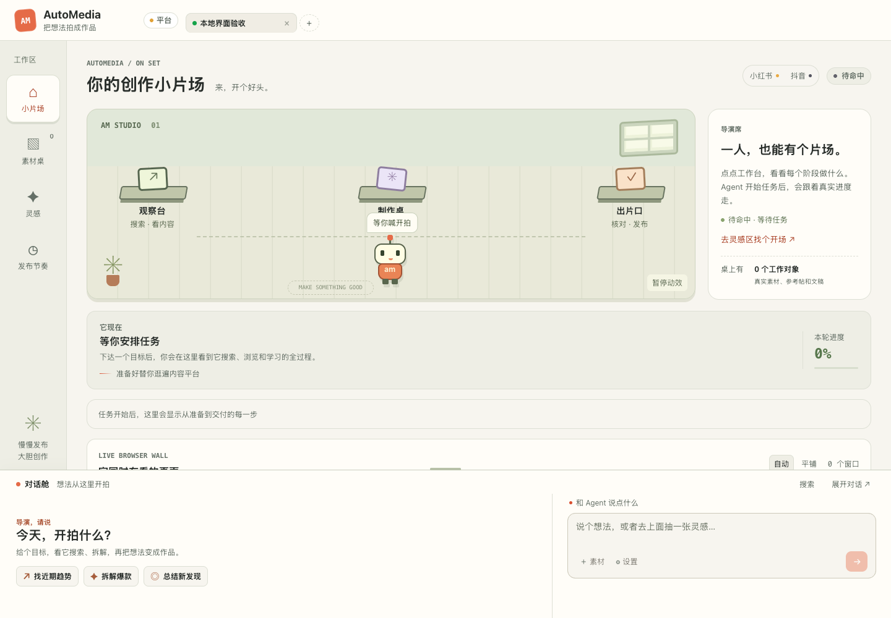
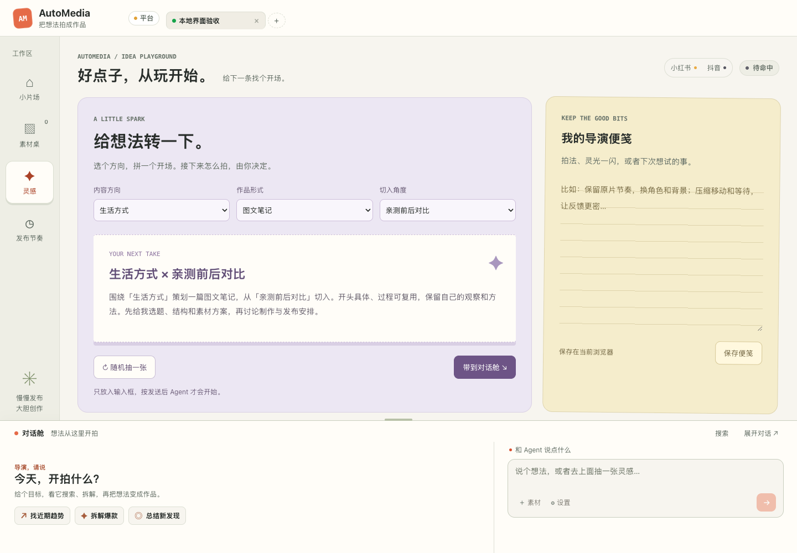
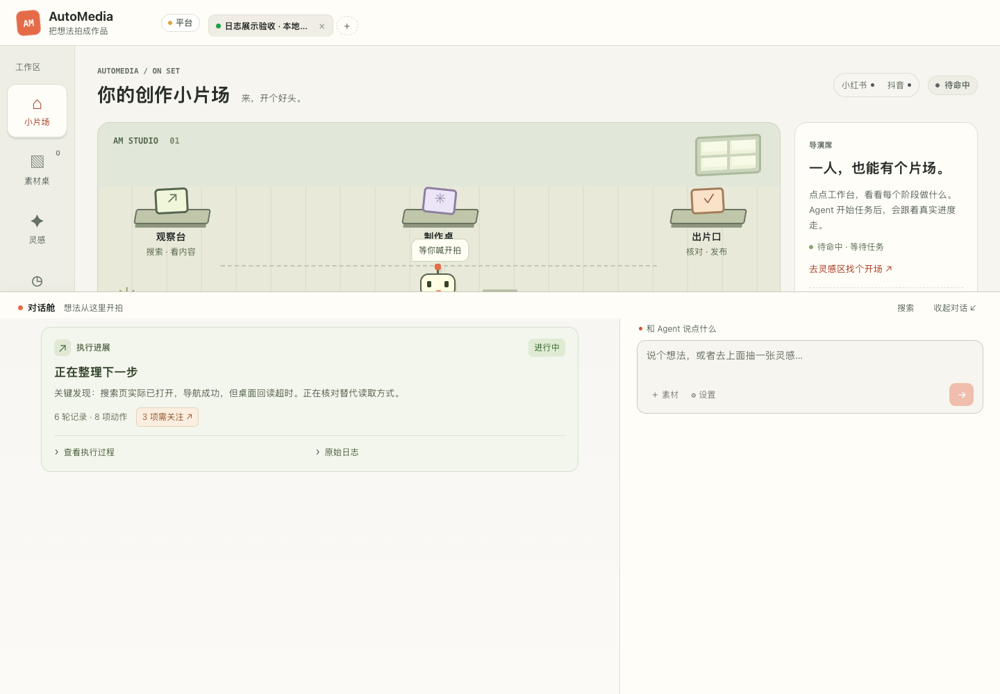

# AutoMedia Agent｜可视化小红书 AI 创作与运营工作台

**从真实样本到内容成稿，再到受控发布，把你的创作流程放进一个本地“小片场”。**

A local AI workspace for Xiaohongshu research, multimodal content creation, and controlled publishing.

[快速开始](#快速开始) · [界面预览](#界面长什么样) · [能力与边界](docs/CAPABILITY_MATRIX.md) · [文档导航](docs/DOCUMENTATION_MAP.md) · [参与贡献](CONTRIBUTING.md)



*实际 Studio 界面，使用本地演示数据；截图展示交互，不代表平台任务已完成。*

## 给一个目标，留下可复用的成果

| 你想做什么 | 工作台帮你完成什么 | 最终留下什么 |
|---|---|---|
| 找选题和内容机会 | 搜索真实笔记，深读正文、评论与可获取的媒体 | 带来源的研究报告、待验证的内容假设 |
| 做一篇更好的内容 | 提炼标题、脚本与正文；看图、生图、改图；理解真实视频 | 文案、素材版本与修改依据 |
| 把内容送进小红书 | 准备图文、视频、长文或播客，回读字段，按规则提交 | 发布记录与独立核对结果 |
| 管理持续创作 | 草稿、作品、合集、定时与任务队列 | 可接续的任务状态、冷却与额度提示 |
| 让经验越用越值钱 | 把证据支持的方法整理成 Skills | 可复用的工作流与个人创作方法 |

研究需要真实页面与媒体成功载入；报告遇到缺证据会保留缺口。其他网站可以使用通用浏览器探索，**当前平台专用发布能力聚焦小红书**。

## 界面长什么样

上方是可切换的工作区，下方是可展开、可拖动调高的对话。暖纸白、珊瑚橙与薄荷色让操作更轻松，小角色跟随真实任务状态变化。

| 工作区 | 可以直接操作的内容 |
|---|---|
| 调研站 | 查看研究进度、来源与交付物 |
| 素材台 | 筛选图片、视频和文件，聚焦预览，保持视频连续播放 |
| 灵感台 | 组合主题与表达方式、灵感抽签、保存导演便笺 |
| 发布节奏 | 查看账号绑定、冷却、额度与队列状态 |



执行过程也有自己的进展卡：先看当前动作和需关注项，按需展开历史、参数与原始回读；最终报告保留完整正文。



“工具已返回”与“发布成功”分别表达。页面超时、账号限制、额度不足都会保留实际状态。

## 目前能做到哪一步

截至 2026-10-28，macOS 已登录 Chrome 的桌面通路是主要真实验收环境。

| 能力 | 当前证据 | 使用边界 |
|---|---|---|
| 文本、视觉、生图、改图 | 真实模型接口已验证 | 需要自己的模型配置与权限 |
| 搜索、筛选、详情、评论、主页 | 真实页面已验证 | 返回已加载内容；不承诺全量采集 |
| 图文 / 视频 / 长文 / 播客 | 四种格式上传、草稿恢复、仅自己可见发布、管理回读与清理有历史实证 | 公开实际发布及完整媒体质量核对仍待验收 |
| 定时与作品管理 | 定时字段独立回读、修改、可见性调整、删除有实证 | 当前账号权限与页面状态决定可用性 |
| 点赞、收藏、关注、评论与指定回复 | 自有测试中的单次提交与独立核对已验证 | 受身份绑定和共享额度控制 |
| 草稿与合集 | 四类草稿；普通合集绑定、播客单合集管理已验证 | 多播客目标、部分普通合集入口未完整验收 |
| RSS / 私信 / 数据与商业入口 | 表单或读取能力已接入 | RSS最终导入、私信真实发送、商业权限未完整验收 |
| 抖音等其他网站 | 通用浏览器探索入口 | 没有专用发布闭环；最新双平台趋势研究仍有连接缺口 |

这是可执行的本地工作台。平台结构、登录状态和账号权限会影响结果，完整说明见[能力矩阵](docs/CAPABILITY_MATRIX.md)。

## 试试这些任务

```text
搜索小红书近期咖啡探店笔记，每轮深读3–5篇，
记录正文、已加载评论和媒体证据，输出带来源的选题报告；不互动、不发布。
```

```text
分析这张封面，结合我提供的参考图解释差距，
给出标题方向和改图方案，保留每个版本。
```

```text
用我指定的本地图片与文案准备一篇笔记，先预览，
回读标题、正文、话题和可见性。
```

平台提交默认仅自己可见；预览只预填，保存草稿是一次写操作。发布前需完成账号绑定与预算检查。

## 快速开始

准备 Python **3.10–3.13**（推荐 3.12）、Git 和 Chrome。纯工作台无需 Node.js 构建；小红书桌面操作主要验收于 macOS。

### 1. 安装

```bash
git clone https://github.com/wangzai-double-milk/AutomediaAgent.git
cd AutomediaAgent
python3.12 -m venv .venv
source .venv/bin/activate
python -m pip install --upgrade pip
python -m pip install -e ".[desktop]"
```

只用文本工作台可安装 `-e .`；大视频代理处理再加 `".[media]"`。Windows 的环境创建与调用方式见[安装说明](docs/installation_zh.md)，Windows/Linux 平台动作尚未完成同等验收。

### 2. 配置模型

```bash
cp -n config.example.json config.json
```

填入自己的火山方舟 Key 与已开通的模型 ID。支持 `AUTOMEDIA_CONFIG` 指定配置文件，以及 `VOLC_API_KEY`、`VOLC_LLM_MODEL`、`VOLC_VLM_MODEL`、`VOLC_GEN_MODEL`、`VOLC_EDIT_MODEL` 等环境变量。`mykey.py` 是配置适配器。

配置与任务记录留在本机；模型调用会把选定的文本和媒体发送给配置的模型服务。

### 3. 启动小片场

```bash
python -m ga_cli studio
```

默认打开 <http://127.0.0.1:14168>。更换端口：

```bash
BRIDGE_PORT=14169 python -m ga_cli studio
```

终端模式使用 `python -m ga_cli cli`。日常命令见[启动速查](HOW_TO_RUN.md)。

### 4. 接入浏览器

macOS 桌面通路需要 `".[desktop]"`、系统辅助功能授权与已登录的 Chrome。先运行“检查登录并读取账号状态，不互动、不发布”的任务。

CDP 通路需要加载 `assets/tmwd_cdp_bridge/` Chrome 扩展并初始化桥接配置，**只打开 9222 端口不足以建立连接**。验证码由用户在平台完成。详细步骤见[安装与排障](docs/installation_zh.md)。

## 发布为什么可控

身份核对、共享额度、提交记录与结果核对一起约束实际动作：

- 默认测试控制开启，后台队列暂停；写操作需要绑定健康账号的稳定 ID。
- 共享提交间隔至少 30 分钟，单账号滚动 24 小时最多 4 次提交、其中发布最多 1 次。保存、互动、修改与删除也占额度。这些是项目工程上限，不是平台安全承诺。
- 提交前写入记录；结果未知保留首次错误，只读核对，禁止自动重发。
- 账号出现限制提示时停止写操作，保留任务与草稿；验证码和权限问题由平台流程处理。

Studio 只监听本机，具备文件读写、代码执行和浏览器操作权限，适合自己管理模型、账号与素材的创作者及技术运营团队。目前没有多账号权限隔离或托管 SaaS。规则见[账号与测试控制](docs/NEW_ACCOUNT_TEST_CONTROL.md)。

## 扩展你自己的方法

```text
agentmain.py / agent_loop.py  会话与任务循环
ga.py / llmcore.py            工具执行与模型协议
frontends/studio.py           Studio 入口
frontends/desktop/static/     原生 HTML / CSS / JavaScript 界面
tools/                       浏览器、媒体、发布与任务原子能力
skills/registry.json          技能依赖与工具前置规则
skills/                      工作流与可复用内容方法
```

Skills 管判断与方法，Tools 管动作。依赖方向是 `Router → Workflow → Capability → Resource`。动态工具需要成对的 `tool.json` 和同步 `execute.py`；`web_`、`xhs_` 前缀保留给内置受控工具。见[技能架构](skills/ARCHITECTURE.md)。

欢迎贡献平台页面变化的最小复现、媒体理解案例与可复用 Skill。后续重点是补齐已接入但未实测的 RSS、多合集与权限入口，完善跨系统浏览器验收。

## 验证与文档

```bash
python -m pip install -e ".[dev]"
python -m pytest -q
python scripts/check_skill_graph.py
python -m build
```

[当前能力](docs/CAPABILITY_MATRIX.md) · [日常文档导航](docs/DOCUMENTATION_MAP.md) · [本轮验证](docs/RELEASE_VALIDATION.md) · [GitHub 展示与曝光建议](docs/OPEN_SOURCE_DISCOVERABILITY.md)

## License

[MIT](LICENSE)。基于 [GenericAgent](https://github.com/lsdefine/GenericAgent) 框架扩展；上游与借鉴来源见[来源说明](docs/PROJECT_SOURCES.md)。模型服务、平台账号与素材仍受各自条款和版权约束。
