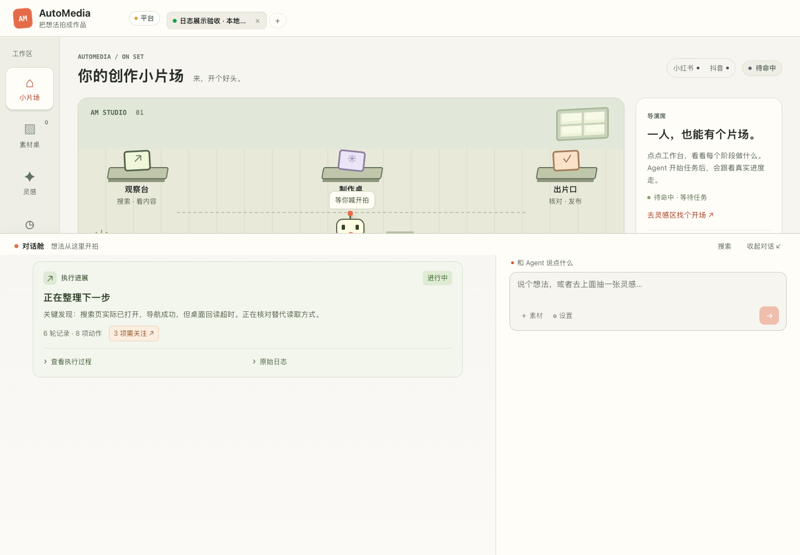
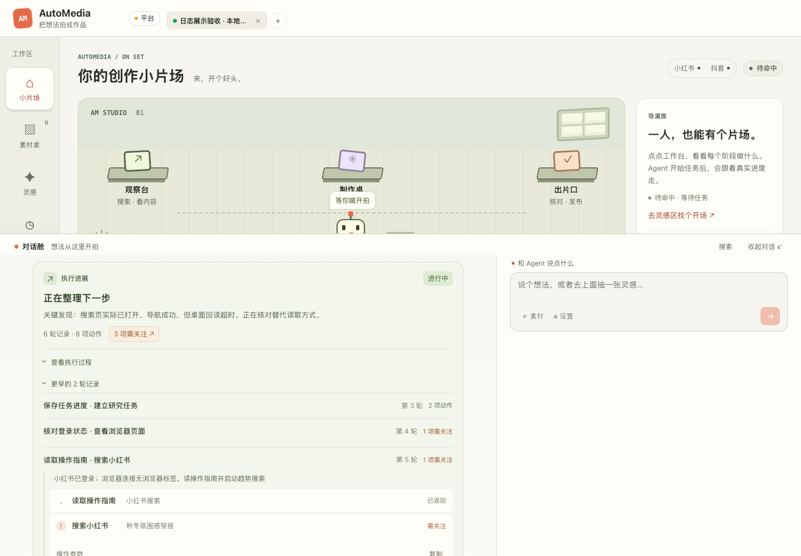

# Studio 执行进展卡

底部对话默认展示当前动作、简短进展、记录数与需关注项。展开后可查看历史阶段、工具参数、原始回读和完整日志；搜索可定位未展开的原文，详情在流式和结束渲染后保持展开状态。

## 状态表达

- 已返回：存在工具回读，不代表业务完成。
- 执行中 / 回读中：动作或输出尚未结束。
- 未回读：运行结束但缺少该动作结果。
- 需关注：超时、error、deferred、restricted 等实际返回。
- 运行结束 / 已停止：生命周期状态，不能替代成功证据。

参数和回读用文本展示，普通 Markdown 与旧 XML 保留原渲染路径。代码或指南中的“error”字样不会直接当作工具错误，围栏内部的 Turn/Tool 文字不会生成虚构动作。

`execution-feed.js/.css` 负责解析与呈现，`app.js` 接入流式与最终消息。截图来自隔离本地示例，只验证展示效果。当前测试范围见[本轮验证](RELEASE_VALIDATION.md)。
